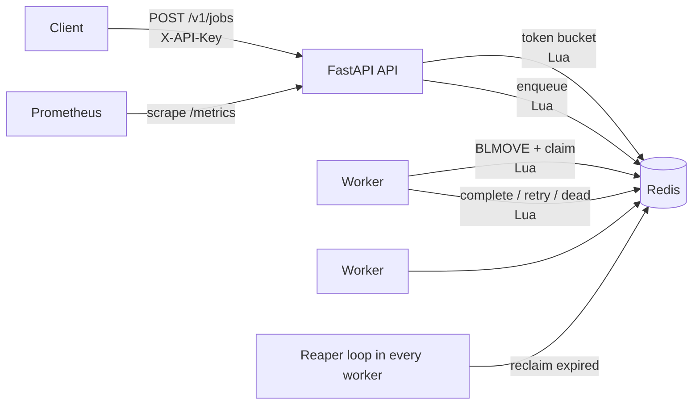
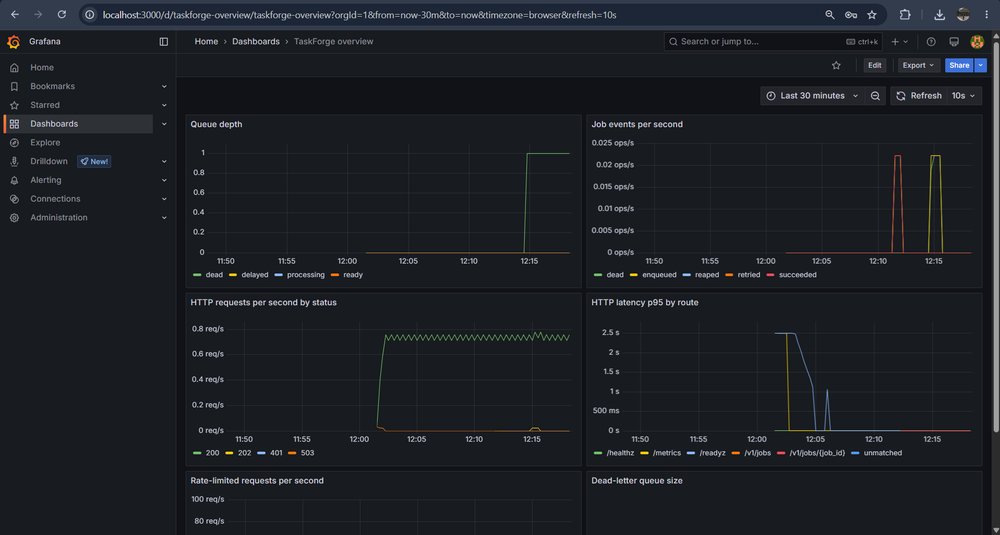
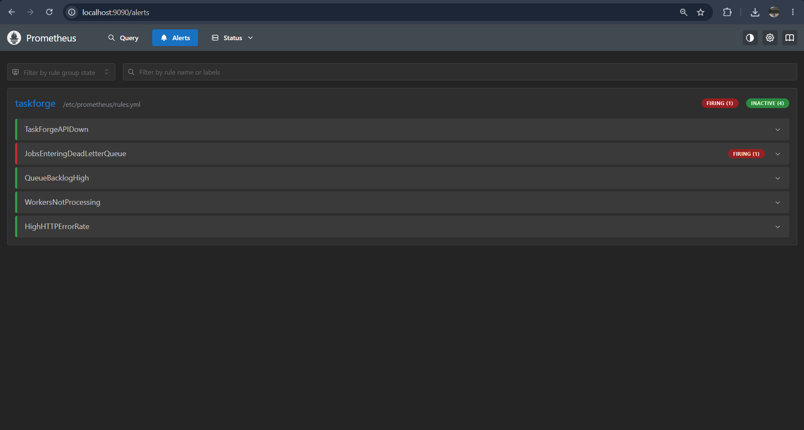
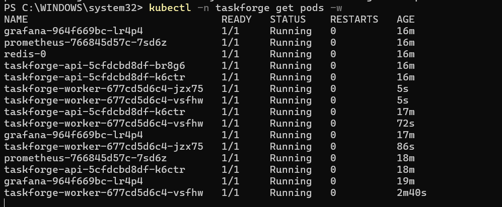

# TaskForge

Live demo: https://taskforge-api-dfd1.onrender.com/docs (free tier, the first request can take about a minute; the interactive docs are open, but job endpoints need an API key)

A reliable background-job queue with a distributed rate limiter, built on **FastAPI** and **Redis**.
Jobs survive worker crashes, retry with exponential backoff, land in a dead-letter queue when they
keep failing, and can be submitted idempotently.


## Features

- **Reliable delivery**: at-least-once. A job claimed by a worker that dies is reclaimed after a visibility timeout.
- **Retries with backoff**: exponential backoff with jitter, configurable max attempts, then a dead-letter queue with one-call replay.
- **Delayed jobs**: schedule a job up to 24 h ahead.
- **Idempotent enqueue**: `Idempotency-Key` header; replays return the original job id.
- **Distributed rate limiting**: token bucket per API key, atomic across any number of API instances.
- **Multi-tenant isolation**: a job is only visible to the API key that created it (other keys get 404).
- **Observability**: structured JSON logs with request IDs, Prometheus `/metrics` (HTTP + queue depth + job counters), `/healthz` and `/readyz`.
- **Graceful shutdown**: on SIGTERM workers stop claiming and let in-flight jobs finish.

## Architecture



Redis keys (prefix `tf`): `job:<id>` (hash), `queue:ready` (list), `queue:delayed` (zset by run-at),
`queue:processing` (list), `queue:inflight` (zset by visibility deadline), `queue:dead` (list),
`idem:<owner>:<key>`, `rl:<owner>`, `stats` (counters).

## Design decisions

| Decision | Why |
|---|---|
| Every multi-key state change is a **Lua script** | Redis runs scripts atomically, so a crash or a concurrent worker can never observe a half-applied transition (e.g. removed from `processing` but not yet in `delayed`). |
| All timestamps come from **Redis `TIME`** | Retry schedules and rate limits stay correct even if API/worker hosts have clock skew. |
| **At-least-once**, not exactly-once | Exactly-once is not achievable across a crash without cooperation from the job's side effects. Handlers must be idempotent; the claim script also skips jobs already finished, which suppresses most duplicates. |
| Reaper **adopts orphans** | A worker can die between `BLMOVE` and the claim script, leaving an id in `processing` with no deadline. The reaper gives it one so it is retried rather than stuck forever. |
| **Blocking connection pool** | Under a burst, requests wait for a connection instead of failing. (Found by a failing concurrency test.) |
| Raw API keys are **never stored** | Redis only sees `sha256(key)[:16]`; keys are compared with `hmac.compare_digest`. |
| State is **Redis only** | One dependency to run, and nothing that expires on free hosting tiers. Trade-off: durability depends on Redis persistence (AOF in `docker-compose.yml`). |
| Counters are **published at 0** from the first scrape | A series that first appears with a non-zero value makes Prometheus miss the first event, so the first-ever dead-lettered job would never alert. |

## Quick start

```bash
docker compose up --build        # redis + api + 2 workers
curl -s -X POST localhost:8000/v1/jobs \
  -H "X-API-Key: dev-key-change-me" -H "Idempotency-Key: demo-1" \
  -H "Content-Type: application/json" \
  -d '{"type":"sum","payload":{"numbers":[1,2,3]}}'
# {"id":"<job-id>","status":"queued","duplicate":false}

curl -s -H "X-API-Key: dev-key-change-me" localhost:8000/v1/jobs/<job-id>
curl -s localhost:8000/metrics | grep taskforge_
```

The commands above are for bash (on Windows use Git Bash, or the interactive docs at `http://localhost:8000/docs`).

Without Docker: `pip install -r requirements-dev.txt`, start Redis, then
`TF_API_KEYS=dev uvicorn app.main:app` and `python -m app.worker` in two terminals.

### API

| Method and path | Purpose |
|---|---|
| `POST /v1/jobs` | Enqueue `{type, payload, max_attempts?, delay_seconds?}`. `202` new, `200` idempotent replay. |
| `GET /v1/jobs/{id}` | Status, attempts, result or last error. |
| `POST /v1/jobs/{id}/retry` | Replay a job from the dead-letter queue. |
| `GET /v1/queue/stats` | Queue depths and cumulative counters. |
| `GET /healthz`, `/readyz`, `/metrics` | Liveness, readiness (pings Redis), Prometheus. |

Built-in job types: `echo`, `sum`, `sleep`, `fail`, `flaky`. Add your own with `@register("name")` in `app/handlers.py`.

## Testing

```bash
pytest --cov=app        # needs Redis on localhost:6379 (tests use DB 15 only)
ruff check . && ruff format --check .
```

38 tests, 92% line coverage, run against a **real Redis** (not a mock). They cover atomicity under
200 concurrent rate-limit callers, no double-delivery under 50 concurrent claims, crash recovery
via the reaper, orphan adoption, retry/DLQ flow, graceful shutdown, tenant isolation, and 503 behaviour
when Redis is down. CI runs the suite, validates the Kubernetes manifests, and builds the Docker image on every push.

## Kubernetes and monitoring

TaskForge also runs on Kubernetes with autoscaling, Prometheus alerts and a Grafana dashboard.
Full details, run instructions and an honest verification table are in [deploy/README.md](deploy/README.md).

Verified on a Docker Desktop (kind) cluster: all pods healthy, HPA reading metrics, Grafana dashboard populated,
dead-letter alert fired, and worker pods replaced after deletion. Not verified: HPA scaling under load and
NetworkPolicy enforcement.

Grafana dashboard, with job traffic:



Dead-letter alert firing in Prometheus after a job exhausted its retries:



Worker pods replaced by Kubernetes within seconds of being deleted:



## Benchmarks

Measured with `scripts/bench.py` on a **1 vCPU sandbox where Redis, the app and the load generator
all share one core**, so treat these as a floor, not a ceiling. Re-run on your hardware and replace them.

| Benchmark | Result |
|---|---|
| Worker throughput, 1 process (echo jobs, 20k jobs, logging off) | ~2,200 jobs/s |
| Enqueue throughput, in-process | ~5,000 jobs/s |
| `POST /v1/jobs` over HTTP (10k requests, 64 concurrent, all `202`) | ~148 req/s, p50 272 ms, p95 1.3 s (load generator and server contending for one core) |

Adding worker processes did **not** help on the 1-core sandbox (2,091, 1,852, 1,660 jobs/s for 1, 2 and 4
processes), which is expected when everything competes for one CPU. Multi-core scaling is not demonstrated
here; run `python scripts/bench.py worker --processes N` on a multi-core machine to measure it.

## Deploy

**Render (free tier, GitHub only):** push this repo to GitHub, then in the Render dashboard choose
*New, Blueprint* and select the repo. `render.yaml` creates the API (Docker) and a Key Value instance, wires
`TF_REDIS_URL`, generates `TF_API_KEYS`, and runs the worker inside the API process. Deployed this way and
verified: a job enqueued through the live URL ran and returned its result.

Free-tier caveats (from Render's docs): the service sleeps after 15 minutes idle (first request takes
about a minute), and the free Key Value store is in-memory, so queued jobs are lost if it restarts.
Fine for a demo, not for production.

**Anywhere else:** CI publishes the image to `ghcr.io/chrisbrown1306/taskforge`; run it with a Redis URL,
and run `python -m app.worker` as a separate process for real deployments.

## Configuration

All settings are environment variables prefixed `TF_` (see `.env.example` and `app/config.py`):
`REDIS_URL`, `API_KEYS`, `RATE_LIMIT_CAPACITY`, `RATE_LIMIT_REFILL_PER_SEC`, `VISIBILITY_TIMEOUT_S`,
`JOB_TIMEOUT_S`, `MAX_ATTEMPTS_DEFAULT`, `BACKOFF_BASE_S`, `WORKER_CONCURRENCY`, `EMBEDDED_WORKER`,
`METRICS_TOKEN`, `LOG_LEVEL`.

## Known limitations

- At-least-once delivery: handlers must be idempotent.
- Redis is a single point of failure; Redis Cluster is not supported (scripts touch multiple keys).
- `GET /v1/queue/stats` shows global queue depth to any authenticated key.
- No job priorities or per-queue concurrency limits yet.
- HPA scaling under load and NetworkPolicy enforcement have not been verified.

## License

MIT, see [LICENSE](LICENSE).
