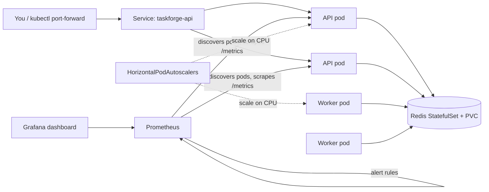

# TaskForge on Kubernetes (with monitoring)

Runs TaskForge as a small production-style platform on a local Kubernetes cluster
(Docker Desktop): separate API and worker deployments, Redis with persistent storage,
autoscaling, Prometheus alerts, and a Grafana dashboard.



## What is in here

| Piece | Details |
|---|---|
| API | 2 to 6 replicas (HPA on CPU), rolling updates with zero unavailable pods, PodDisruptionBudget, readiness probe on `/readyz` (depends on Redis), liveness on `/healthz` (does not, so a Redis outage never restart-loops the API) |
| Workers | 2 to 8 replicas (HPA), `terminationGracePeriodSeconds: 30` so in-flight jobs finish on shutdown |
| Redis | StatefulSet, 1 Gi PVC, AOF on, `noeviction` |
| Hardening | non-root, read-only root filesystem, all capabilities dropped, seccomp `RuntimeDefault`, namespaced RBAC for Prometheus, NetworkPolicy limiting Redis access |
| Secrets | API key and Grafana password are generated by `up.ps1` and never stored in git |
| Monitoring | Prometheus (pod discovery) with 5 alert rules; Grafana with a provisioned 6-panel dashboard |
| Config | Kustomize with generated ConfigMaps (editing a value rolls the pods) |

Alerts: API down, jobs entering the dead-letter queue, queue backlog above 1000 for 5 min,
workers not processing while jobs wait, 5xx rate above 5%.

## Run it

Prerequisites: Docker Desktop with Kubernetes enabled, `kubectl`, and the GitHub package
`taskforge` set to **Public** (GitHub profile, Packages, taskforge, Package settings,
Change visibility) so the cluster can pull the image CI publishes.

```powershell
.\deploy\up.ps1        # creates secrets, installs metrics-server, applies manifests, waits for readiness
```

It prints your API key and Grafana password once. Then, in separate PowerShell windows:

```powershell
kubectl -n taskforge port-forward svc/taskforge-api 8000:80      # http://localhost:8000/docs
kubectl -n taskforge port-forward svc/grafana 3000:3000          # http://localhost:3000  (admin / printed password)
kubectl -n taskforge port-forward svc/prometheus 9090:9090       # http://localhost:9090/alerts
```

Tear down: `.\deploy\down.ps1`.

## Things worth demonstrating

```powershell
# Self-healing: kill a worker mid-flight, watch Kubernetes replace it and jobs still finish
kubectl -n taskforge delete pod -l app.kubernetes.io/component=worker --wait=false
kubectl -n taskforge get pods -w

# Dead-letter alert: enqueue a job that always fails, then open Prometheus -> Alerts
#   POST /v1/jobs  {"type":"fail","max_attempts":1}   (via http://localhost:8000/docs)

# Autoscaling: generate load, then watch replicas grow
kubectl -n taskforge get hpa -w
```

## Design notes

- **Fleet-wide metrics use `max`, not `sum`.** Queue depth and job counters are read from Redis, so every
  API pod reports identical values; summing them would multiply the numbers by the replica count. HTTP
  metrics are per pod and are summed.
- **Counters are published at 0 from the first scrape.** A series that first appears with a non-zero value
  makes Prometheus miss the first event, so the first-ever dead-lettered job would never alert. Found by
  running the real dashboard queries against a live Prometheus; covered by a regression test.
- **Liveness vs readiness.** Only readiness checks Redis. If Redis goes down, pods stop receiving traffic
  but are not killed, so they recover on their own when Redis returns.

## What has and has not been verified

| Check | Status |
|---|---|
| All 23 rendered objects pass Kubernetes schema validation (`kubeconform`, in CI) | Verified |
| Prometheus config and alert rules pass `promtool` | Verified |
| Every dashboard query and alert expression returns data against a live Prometheus scraping a running TaskForge | Verified (locally, outside Kubernetes) |
| Manifests applied to a Docker Desktop (kind) cluster: all pods healthy, HPA reading metrics, Grafana dashboard populated, dead-letter alert fired, worker pods replaced after deletion | Verified |
| HPA actually scaling up under load | Not verified |
| `up.ps1` | Verified: ran on Windows PowerShell and deployed the stack (needs `Set-ExecutionPolicy -Scope Process Bypass` first) |
| NetworkPolicy enforcement | Depends on the cluster's CNI; a plain kind cluster may accept the object without enforcing it |

## Limitations

- Local only: no public URL, so a Kubernetes deployment can be shown through screenshots and this README.
- Prometheus and Grafana use `emptyDir`, so metric history and dashboard edits are lost on pod restart.
- Single-replica Redis is a single point of failure.
- Image tags for Prometheus and Grafana are pinned to known versions and should be bumped periodically.
- `/metrics` is open inside the cluster (set `TF_METRICS_TOKEN` and a Prometheus credential to protect it).
- No Terraform: there is no cloud account to provision. Add it when moving to a managed cluster (EKS, GKE, AKS).
